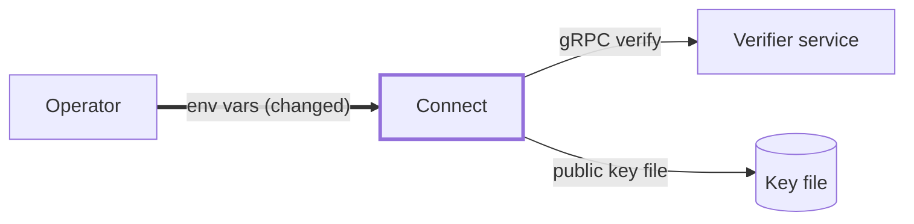

# Issue format

An issue has two halves for two readers. The **Brief** is for the maintainer deciding whether
and when; they can stop reading after it. The **Spec** is for whoever implements it, person or
agent, and must leave them nothing to ask. The same shape serves Bug, Feature and Task; only
the Spec's first fields change.

An issue holds work, never questions (the one exception is a `needs-human` issue's
`## Needs a decision` section, see `readiness.md`). If a decision is still pending (two designs, a naming
choice, "should we?"), it goes to a Discussion and the issue is filed once it's decided.

## Template

````markdown
## Brief
**Problem:** <one sentence: who hits what, when>
**Impact:** <who is affected, how badly, is there a workaround>
**Breaking change:** No | Yes: <what breaks, for whom, the migration>
**Risk:** Low | Medium | High: <what the change could break, how we roll back>
**Size:** S | M
**Why take it:** <one line>
**Why not:** <one line, or "No objection survived the Spec">

### Components
```mermaid
flowchart LR
  <the components this change touches, their direct neighbors, and the contract on each edge>
```
### Contract
<the before and after shape of every contract this change adds, alters or removes, or "None: <why>">

## Spec
### Current behavior
### Expected behavior
### Reproduce
### Where to look
### Scope
In: ...
Out: ...
### Constraints
### Docs
### Acceptance criteria
- [ ] Given ..., when ..., then ...
### Verify
<one command that fails today and passes when done>
````

`Reproduce` is for bugs: exact commands, versions and config, inlined rather than linked. A
feature replaces it with a one-line user story. A task drops it.

## Brief rules

Every field is required. "No" and "Low" are answers; blanks are not.

| Field | Rule |
| :--- | :--- |
| Problem | One sentence with no "and". If it needs two, it is two issues, or it isn't ready. |
| Impact | Who, how badly, and whether a workaround exists. |
| Breaking change | Describes the **change**, not the bug. Yes names what breaks (API, CLI flag, env var, config, schema, wire behavior) and the migration. A Yes maps to `feat!:` or a `BREAKING CHANGE:` footer in the commit. |
| Risk | Blast radius and rollback. High means a human reviews the plan before `ready`. |
| Size | S (under half a day) or M (up to 2 days). L is never filed: split it (see `loop-limits.md` for how far). |
| Why take it | The advocate's line. |
| Why not | The critic's line. A fixable objection becomes a Constraint instead. |

## Components and Contract

The maintainer decides on the contract, not the implementation: an implementation can be
redone in a later PR, a contract other components and developers depend on can't. So the
Brief shows both, drawn by the Architect, and both are required.

**Components** is a Mermaid `flowchart` (GitHub renders it), always present, even for a
one-component change:

- Nodes are components a maintainer recognizes (a service, package, CLI, SDK, database, an
  external system, the developer or operator), never files or functions. At most 10.
- Draw every component the change touches and its direct neighbors. Mark the ones that
  change with `:::changed` and add `classDef changed stroke-width:3px`, so the diagram reads
  without color.
- Label every edge with the contract it carries (`gRPC CreateApp`, `config.yaml`,
  `@fonoster/sdk createApp()`, `NATS calls.started`). An edge whose contract changes is drawn
  thick (`==>`) and its label ends in `(changed)`, or `(new)` / `(removed)`. Quote labels
  that hold parentheses or punctuation (`==>|"env vars (changed)"|`), or Mermaid won't render.

**Contract** shows the shape of every contract the change adds, alters or removes, before and
after, written the way its user writes or sees it, in a code block:

- **Between components** (API, RPC, event, wire format, schema): the request, response or
  message with its fields and types, and the errors a caller can get.
- **Configuration** (config file, env vars): the snippet an operator writes, with defaults,
  and what happens on a bad or missing value.
- **CLI:** the command line a developer types, its flags, and the output and exit code they
  get, including the error case.
- **SDK:** the call as it appears in user code, with its signature and what it returns or
  throws.

Developer-facing shapes (configuration, CLI, SDK) get the most care: show a complete,
realistic example, not a type sketch, because that is what a developer will copy. A new
contract reads "Before: none"; a removed one reads "After: none". "None" is valid only when
nothing that crosses a component boundary or reaches a developer changes, and it says why
("None: the retry loop is internal to the dispatcher"). Every contract a Breaking change of
Yes names appears here.

The Contract is binding. The Implementer builds exactly that shape, and a reason to change it
is a blocker that goes back to the Reporter, not a judgment call in the PR.

## Spec rules

- **Expected behavior** is stated as a fact, not "should probably".
- **Where to look** names files and functions that exist today, plus a similar past change to
  copy when there is one.
- **Out of scope** is never empty. Name the nearby thing you are not doing.
- **Constraints** list what must not change: public APIs, schemas, env vars, wire formats.
- **Docs** names every page, CLI help text, README section or changelog note that must
  change, and what it must say; each becomes an acceptance criterion. "None" only when
  nothing a user or operator reads or does changes. A breaking change always has a
  migration note here.
- **Acceptance criteria** are checkable. Prefer Given / When / Then.
- **Verify** is one command. It fails today for the stated reason and passes when the work is
  done. "For the stated reason" means its output shows the bug (a failing assertion,
  the wrong value), not the environment (command not found, a missing service, a timeout).
  Prefer the repo's own test runner over ad-hoc shell, and commands that run the same on a
  laptop and in CI. For new code, name the test file and the cases the acceptance criteria
  require (`mocha mods/common/test/resolve_refs.unit.test.ts`, cases: ...): "no test files
  found" today is acceptable only then, because a pass must mean those cases ran. If no automated check is possible, say why and give the exact manual steps.
  Its exit code is the verdict. Whoever runs it (Reporter, Implementer, Reviewer) runs it
  bare or with output sent to a file, never through a pipe: `| tail` reports the last
  command's exit code, not Verify's. A chain of steps uses `&&`, never `;`.
- Inline external context (versions, config, env) instead of linking to it. Issues that send
  the implementer elsewhere for context merge less often (see `research.md`).

## Titles and types

- The title is plain words, no `[BUG]` or `feat:` prefix. The issue type (Bug, Feature, Task)
  carries the kind; labels carry area and state (see `labels.md`).
- Related slices link with GitHub's native "blocked by" dependencies. There is no umbrella
  issue.

## Worked example

routr #437, rewritten. The Brief surfaces what the original hid: the fix makes a running
config refuse to start, which is a breaking change.

````markdown
## Brief
**Problem:** Connect starts with two verifiers set because its startup check reads CONNECT_VERIFIER_PUBLIC_KEY, which nothing uses.
**Impact:** Operators who set both get the public-key verifier silently; no data loss.
**Breaking change:** Yes: configs setting both CONNECT_VERIFIER_ADDR and CONNECT_VERIFIER_PUBLIC_KEY_PATH stop starting. Migration: unset one.
**Risk:** Low: one-line change in an env check; roll back by reverting.
**Size:** S
**Why take it:** A config check that never fires hides misconfiguration.
**Why not:** No objection survived the Spec.

### Components

### Contract
Configuration, the case that changes:
```bash
CONNECT_VERIFIER_ADDR=verifier:50051
CONNECT_VERIFIER_PUBLIC_KEY_PATH=/etc/routr/key.pub
```
Before: Connect starts and silently uses the public-key verifier.
After: Connect exits 1 with `only one of CONNECT_VERIFIER_ADDR, CONNECT_VERIFIER_PUBLIC_KEY_PATH may be set`.
Setting either variable alone behaves as today.

## Spec
### Current behavior
mods/connect/src/envs.ts:21 asserts only one of CONNECT_VERIFIER_ADDR / CONNECT_VERIFIER_PUBLIC_KEY is set.
### Expected behavior
The assertion uses CONNECT_VERIFIER_PUBLIC_KEY_PATH, the variable read at envs.ts:43.
### Where to look
mods/connect/src/envs.ts; assertOnlyOneEnvIsSet in mods/common.
### Scope
In: the assertion and its test. Out: renaming env vars, verifier selection in utils.ts.
### Constraints
Env var names stay as they are.
### Docs
docs-site/reference/components/connect.mdx: setting both verifier variables now stops Connect at startup.
### Acceptance criteria
- [ ] Given both vars set, when Connect starts, then it exits non-zero naming both vars.
- [ ] Given only one set, Connect starts as today.
### Verify
npm test -w mods/connect
````
